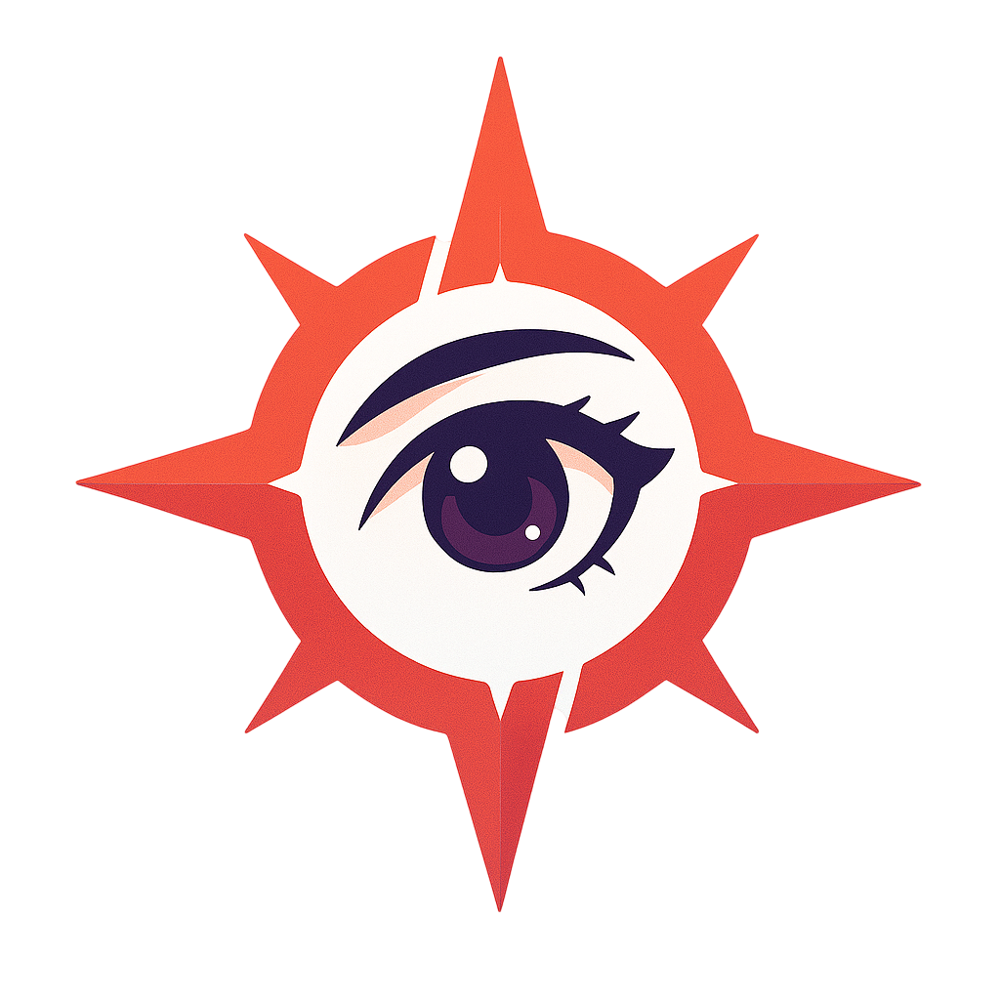
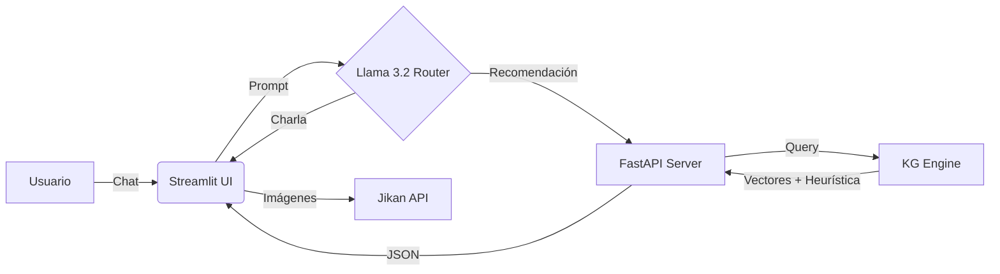

<div align="center">
  
  <h1>AnimeCompass V2</h1>
</div>

<div align="center">


</div>

<br>

> **Un sistema de recomendación Neuro-Simbólico que combina la precisión de los Grafos de Conocimiento con la naturalidad de la IA Generativa.**

---

## 📖 Descripción

**AnimeCompass V2** no es un simple buscador. Es un asistente inteligente basado en el ciclo **CBR (Case-Based Reasoning)** que entiende tus gustos.

A diferencia de los recomendadores tradicionales, este proyecto implementa una **arquitectura híbrida**:
1.  **Cerebro Simbólico (KG):** Un Grafo de Conocimiento con +3000 animes vectorizados mediante **TransR** para capturar relaciones latentes profundas.
2.  **Interfaz Generativa (LLM):** Integración con **Llama 3.2** para entender consultas en lenguaje natural y explicar el "porqué" de cada recomendación.
3.  **Lógica Heurística:** Algoritmos matemáticos que refinan los resultados basándose en géneros, estudios y fechas.

---

## ✨ Características Principales

*   🧠 **Motor Híbrido (80/20):** Combina similitud semántica vectorial (Embeddings TransR) con heurísticas basadas en rasgos explícitos (Jaccard, Decaimiento Exponencial).
*   💬 **Chat Natural:** Habla con el sistema como si fuera un amigo. *"Quiero algo como Evangelion pero más moderno"*.
*   🔄 **Ciclo CBR Completo:**
    *   **Retrieve:** Búsqueda inteligente en el espacio vectorial.
    *   **Reuse:** Presentación enriquecida con datos de la API de Jikan.
    *   **Revise:** Feedback explícito (👍/👎) del usuario.
    *   **Retain:** Aprendizaje continuo y exclusión de animes rechazados.
*   📊 **Métricas en Tiempo Real:** Visualiza tu **MRR (Mean Reciprocal Rank)** y precisión mientras interactúas.
*   🛡️ **Anti-Alucinación:** Mecanismos de seguridad para asegurar que el LLM solo procese entidades reales.

---

## 🏗️ Arquitectura del Sistema

El proyecto sigue una arquitectura modular Cliente-Servidor:



---

## 🚀 Instalación y Uso

### Prerrequisitos
*   Python 3.9+
*   [Ollama](https://ollama.com/) instalado y ejecutándose.
*   Modelo Llama 3.2 descargado: `ollama pull llama3.2`

### 1. Clonar el repositorio
```bash
git clone https://github.com/tu-usuario/anime-compass-v2.git
cd anime-compass-v2
```

### 2. Instalar dependencias
```bash
pip install -r requirements.txt
```
*(Asegúrate de tener `torch`, `streamlit`, `fastapi`, `uvicorn`, `pandas`, `numpy`, `requests`)*

### 3. Preparar los Datos
Asegúrate de que la carpeta `../anime_recommender_final` contiene los archivos del modelo entrenado (`model.pt`, `triples_factory.pkl`, `data_package.pkl`).

### 4. Ejecutar el Servidor (Backend)
En una terminal:
```bash
python mcp_server.py
```
*El servidor iniciará en `http://localhost:8000`*

### 5. Ejecutar la Interfaz (Frontend)
En otra terminal:
```bash
streamlit run app_ui.py
```

---

## 📂 Estructura del Proyecto

*   `app_ui.py`: Interfaz de usuario (Streamlit), gestión de estado y chat.
*   `mcp_server.py`: API REST (FastAPI) que expone el motor de recomendación.
*   `kg_engine.py`: **El núcleo**. Carga los embeddings TransR y calcula la similitud híbrida.
*   `llm_client.py`: Cliente para conectar con Ollama, con lógica de routing y extracción.
*   `jikan_client.py`: Conector con MyAnimeList para obtener carátulas.
*   `db_management.py`: Persistencia simple de usuarios y feedback.

---

## 🔮 Trabajo Futuro

*   [ ] Implementación de **Graph-Based XAI** para explicar recomendaciones mediante caminos del grafo.
*   [ ] Pipeline ETL para actualización automática de animes vía API Jikan.
*   [ ] Filtrado Colaborativo para cruzar perfiles de usuarios similares.

---

## 👤 Autores

Desarrollado como parte de la asignatura de **Grafos de Conocimiento y Razonamiento Basado en Casos**.
- **Pedro Antonio Martín Peláez**: [GitHub](https://github.com/PedroAMP22)
- **Álvaro Ray Martínez**: [GitHub](https://github.com/alvaroray)
---
*Hecho con ❤️ y mucho ☕ viendo Anime.*
